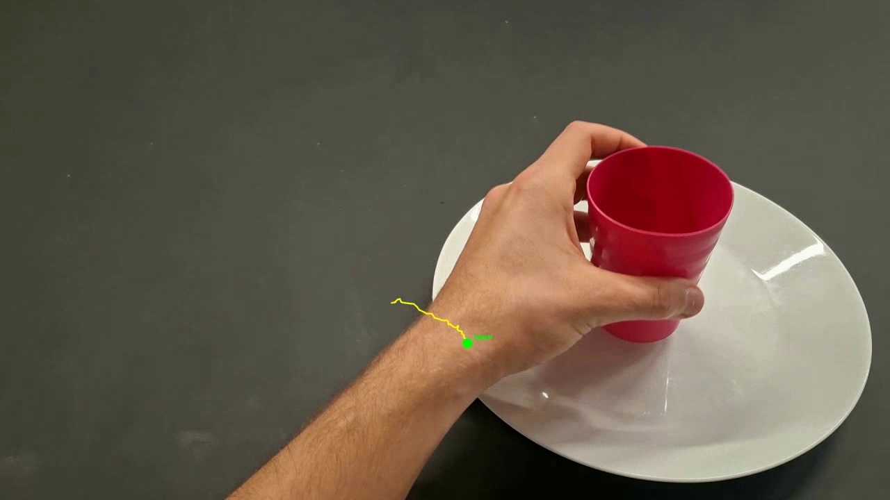

# Humanoid Internship Challenge — Ego → SmolVLA → LIBERO

Public submission for [Humanoid — Internship, Robot Learning Research](https://jobs.ashbyhq.com/humanoid/e1a2a9de-ad23-4632-9d93-ee50fd41a221).

**Constraint met:** personally collected phone egocentric videos drive a simulated Panda (LIBERO / MuJoCo) via VLA finetuning, with a small world-model teaser on the same data.

**Deadline:** Friday, 16 October 2026, 23:59 BST · **Repo:** https://github.com/notifdust/Humanoid-Internship-Project

**Demo reel (~47s):** [`outputs/demo/challenge_demo.mp4`](outputs/demo/challenge_demo.mp4) — ego overlay → SmolVLA → side-by-side → LIBERO → MuJoCo → WM → results card.  
Regenerate: `.\scripts\make_demo.ps1`



---

## Idea in one picture

```
Phone ego (42 clips, fuchsia mug → white plate)
    → 1080p + MediaPipe Hands
    → wrist → Panda EE deltas (EgoVLA-inspired retarget)
    → LeRobot episodes
    → SmolVLA light finetune (RTX 4060)
    → LIBERO / MuJoCo rollouts
    + tiny action-conditioned future-frame WM teaser
```

Left side of the challenge example (ego hand video) is **our data**. Right side (Panda in LIBERO) is **our open-loop / proxy sims** driven by retargeted / predicted actions.

---

## Results (what worked / what didn’t)

| Check | Result |
|-------|--------|
| Personal data used for training | Yes — 42 ego clips → dataset → SmolVLA finetune |
| Held-out action MSE | pretrained **0.029** → finetuned **0.023** → BC **0.021** (`outputs/eval/ablation_mse.json`) |
| Ego overlay | `outputs/eval/smolvla_rollout_41.mp4` |
| Side-by-side ego \| pred \| LIBERO | `outputs/eval/side_by_side_41.mp4` |
| MuJoCo EE proxy | `outputs/eval/mujoco_ee_smolvla_41.mp4` |
| LIBERO open-loop from personal actions | `outputs/eval/libero_openloop_smolvla_41.mp4` |
| LIBERO closed-loop (ego-finetuned) | `outputs/eval/libero_closedloop_ego_ft.mp4` — **task fail** (domain gap) |
| Open-loop multi-seed | **0/5** success (`outputs/eval/libero_openloop_multiseed.json`) — expected |
| WM future-frame strips | `outputs/wm/future_frame_strip_{30,41}.gif` |
| Retarget QA | `outputs/viz/retarget/*_retarget.png` |

**Worked:** personal-data finetune improves over base SmolVLA on our retargeted action proxy; full Windows+WSL pipeline is reproducible; WM teaser shows action-conditioned video prediction on ego frames.

**Didn’t work / honest limits:** no robot teleop; monocular depth is approximate; closed-loop ego→LIBERO fails because camera/action spaces differ from `smolvla_libero`; open-loop does not solve LIBERO object tasks (different objects/scene). Personal data’s clearest role is **training signal + open-loop motion transfer**, not LIBERO task success.

Large videos/checkpoints are **gitignored** (see paths above). Clone + regenerate with the commands below, or inspect local `outputs/` if you already ran the pipeline.

---

## Quick start

```powershell
# Windows Python 3.12 + CUDA (.venv)
.\.venv\Scripts\python.exe -m src.train.train_smolvla_custom --steps 2000 --out outputs/train/smolvla_custom
.\.venv\Scripts\python.exe -m src.eval.rollout_smolvla_overlay
.\.venv\Scripts\python.exe -m src.eval.ablation_mse
.\.venv\Scripts\python.exe -m src.viz.make_side_by_side
.\.venv\Scripts\python.exe -m src.wm.train_future_frame
.\.venv\Scripts\python.exe -m src.wm.make_wm_gif
.\.venv\Scripts\python.exe -m src.viz.plot_retarget
.\scripts\make_demo.ps1   # -> outputs/demo/challenge_demo.mp4

# WSL2 LIBERO (mujoco==3.1.1, robosuite==1.4.1, lerobot==0.3.2)
wsl -e bash scripts/wsl_run_libero_rollout.sh
wsl -e bash scripts/wsl_run_libero_closedloop.sh
wsl -e bash scripts/wsl_run_libero_multiseed.sh
```

Phase scripts: `scripts/run_phase_a.ps1`, `run_phase_b_dataset.ps1`, `run_phase_c_install.ps1`.  
How to inspect outputs: [`docs/HOW_TO_CHECK.md`](docs/HOW_TO_CHECK.md).

---

## Design choices

1. **EgoVLA-style story** — MediaPipe first (fast on 4060); HaMeR / full IK deferred.
2. **Custom SmolVLA trainer** — Windows NamedTemporaryFile / LeRobot CLI issues → `src/train/train_smolvla_custom.py`.
3. **BC baseline** — tiny CNN still wins the MSE proxy; kept as control.
4. **WM as secondary** — tiny CNN future-frame predictor (IRASim / Ha–Schmidhuber framing), not full UWM.
5. **LIBERO eval pins** — see [`docs/RESEARCH_CLOSEDLOOP.md`](docs/RESEARCH_CLOSEDLOOP.md).

Plan / checklist: [`docs/GUIDELINE.md`](docs/GUIDELINE.md) · Application paste: [`docs/SUBMISSION.md`](docs/SUBMISSION.md)

---

## Layout

```
data/          # raw ego (gitignored) + labels.csv
src/           # preprocess, hands, retarget, dataset, train, eval, wm, viz
scripts/       # Windows + WSL one-shots
docs/          # GUIDELINE, HOW_TO_CHECK, RESEARCH_CLOSEDLOOP, SUBMISSION
outputs/       # videos, plots, checkpoints (gitignored)
resources/     # paper / GitHub reading lists
```

## License

MIT — [`LICENSE`](LICENSE). Third-party papers/books keep their own terms.
